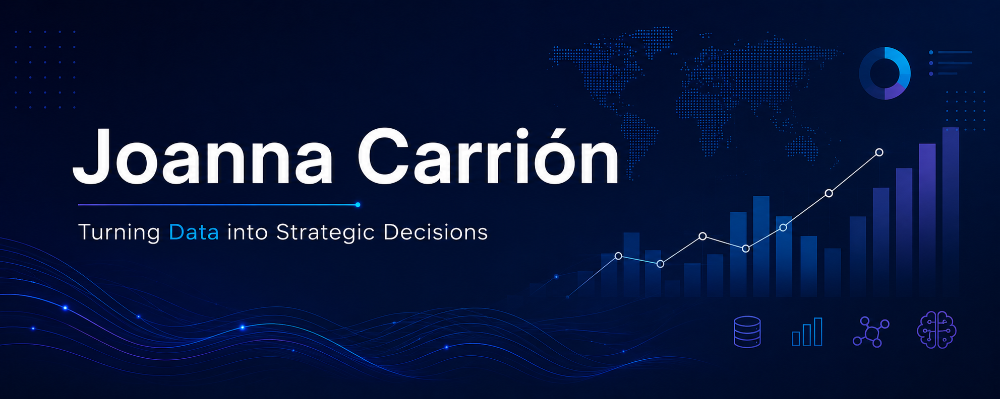

<!-- PANEL ANIMADO - terminal con mis datos + retrato de píxeles.
     Generado por scripts/generate_banner.py. Cambia ?v=N después de regenerarlo. -->
<picture>
  <source media="(prefers-color-scheme: dark)"  srcset="assets/banner-dark.svg?v=1">
  <source media="(prefers-color-scheme: light)" srcset="assets/banner-light.svg?v=1">
  
</picture>

<!-- Si quieres mantener tu portada también, quita los guiones de esta línea:

-->

 

<!-- NOMBRE / TAGLINE - texto animado -->

 

<!-- REDES - LinkedIn mantiene su azul de marca; el resto usa el acento del perfil -->
&nbsp;&nbsp;
&nbsp;&nbsp;

 

---

## ✨ Esta soy yo

Hola, soy **Joanna**, egresada de **Ingeniería Electrónica** y desarrolladora apasionada por los datos.
Me gusta convertir datos en decisiones y llevar la inteligencia artificial del notebook al mundo real.
He participado en proyectos interdisciplinarios que me enseñaron a diseñar e implementar soluciones tecnológicas de principio a fin.

- 📊 **Data Analytics & BI**: dashboards en Power BI, consultas SQL y análisis en Python para apoyar la toma de decisiones.
- 🤖 **IA y Machine Learning**: clasificación de imágenes y reconocimiento de voz con redes neuronales.
- 🔌 **Sistemas Embebidos y Hardware**: mi base en electrónica me permite conectar el software con el mundo físico.
- 👁️ **Visión por Computadora y Procesamiento de Señales**: de la segmentación por color a la transformada wavelet.
- ⚙️ **Automatización**: soluciones digitales que ahorran tiempo y reducen errores.
- 🌱 **Lo que me mueve:** explorar nuevas tecnologías, resolver desafíos complejos y aportar a iniciativas de impacto.
- 💬 Háblame de **datos, IA o proyectos interdisciplinarios** y tendrás toda mi atención.

---

## 🧭 Lo que hago

<table>
<tr>
<td width="33%" valign="top" align="left">

<h4>📊 Datos y BI</h4>

Transformo datos en información clara para decidir mejor.

- Dashboards e informes en **Power BI**
- Consultas y modelado con **SQL**
- Limpieza y análisis con **Python**

</td>
<td width="33%" valign="top" align="left">

<h4>🤖 IA y Machine Learning</h4>

Entreno y aplico modelos que reconocen patrones.

- Clasificación de imágenes con **modelos preentrenados**
- **Redes neuronales** para voz y señales
- **TensorFlow** y **PyTorch**

</td>
<td width="33%" valign="top" align="left">

<h4>🔌 Electrónica y Señales</h4>

Llevo los algoritmos al hardware y al mundo real.

- **Visión por computadora** con cámara
- **Procesamiento de señales** y wavelets
- **Sistemas embebidos** y **MATLAB**

</td>
</tr>
</table>

---

## 🛠️ Mi stack

<table>
<tr>
<td align="right"><b>Datos y BI</b></td>
<td>
&nbsp;
&nbsp;

</td>
</tr>
<tr>
<td align="right"><b>IA / ML</b></td>
<td></td>
</tr>
<tr>
<td align="right"><b>Señales y visión</b></td>
<td></td>
</tr>
<tr>
<td align="right"><b>Web y herramientas</b></td>
<td></td>
</tr>
</table>

---

## 🚀 Proyectos destacados

<table>
<tr>
<td width="33%" valign="top">

<h4>🐶 <a href="https://github.com/Joanna20Carrion/Dog-Breed-Classification-Using-Pretrained-Models">Dog Breed Classifier</a></h4>

Clasificación de razas de perros a partir de imágenes, combinando modelos preentrenados de deep learning y procesamiento de imágenes.

</td>
<td width="33%" valign="top">

<h4>🍾 <a href="https://github.com/Joanna20Carrion/Sistema-de-Deteccion-y-Clasificacion-de-Botellas-con-MATLAB">Detección de Botellas</a></h4>

Detección y clasificación de botellas por color y tamaño con una cámara, segmentación y máscaras de color.

</td>
<td width="33%" valign="top">

<h4>🎙️ <a href="https://github.com/Joanna20Carrion/Reconocimiento-de-Voz-con-Redes-Neuronales-y-Transformada-Wavelet">Reconocimiento de Voz</a></h4>

Identificación de comandos de voz básicos con redes neuronales y análisis de señales mediante transformada wavelet.

</td>
</tr>
</table>

---

## 🌱 Aprendiendo ahora

&nbsp;
&nbsp;
&nbsp;
&nbsp;

---

## 📈 ¿Los números importan? ¡Claro que sí!

<!-- Se adapta al tema claro/oscuro de GitHub -->
<picture>
  <source media="(prefers-color-scheme: dark)"  srcset="https://streak-stats.demolab.com?user=Joanna20Carrion&hide_border=true&background=0D1117&ring=007ACC&fire=007ACC&currStreakLabel=007ACC&sideLabels=C9D1D9&dates=8B949E&stroke=30363D&currStreakNum=FFFFFF&sideNums=FFFFFF&locale=es">
  <source media="(prefers-color-scheme: light)" srcset="https://streak-stats.demolab.com?user=Joanna20Carrion&hide_border=true&background=FFFFFF&ring=007ACC&fire=007ACC&currStreakLabel=007ACC&sideLabels=24292F&dates=57606A&stroke=D0D7DE&currStreakNum=24292F&sideNums=24292F&locale=es">
  
</picture>

---

## 💡 En búsqueda constante

Siempre estoy abierta a colaborar en proyectos innovadores y explorar tecnologías que transforman el futuro. 
Si quieres conectar o trabajar conmigo, ¡estaré encantada de conversar!

 

&nbsp;&nbsp;

  

` Hecho con 💙 y muchos datos · Joanna Carrión `

